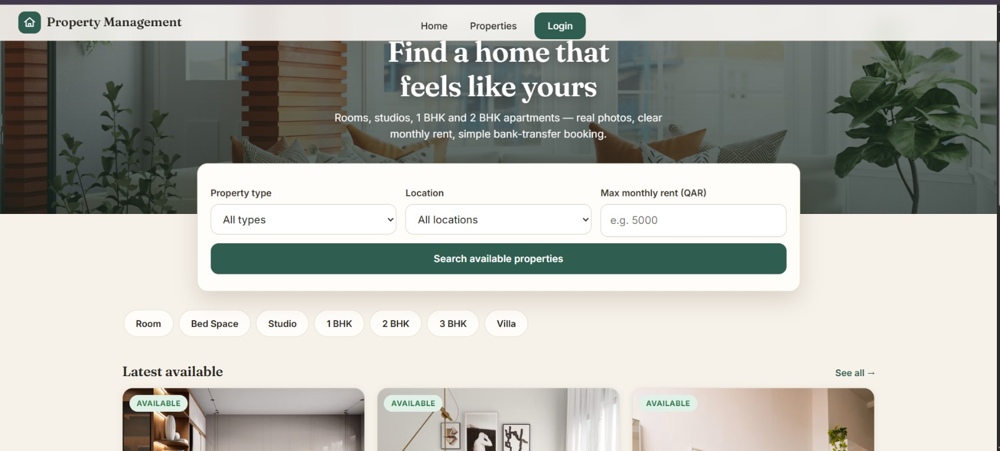
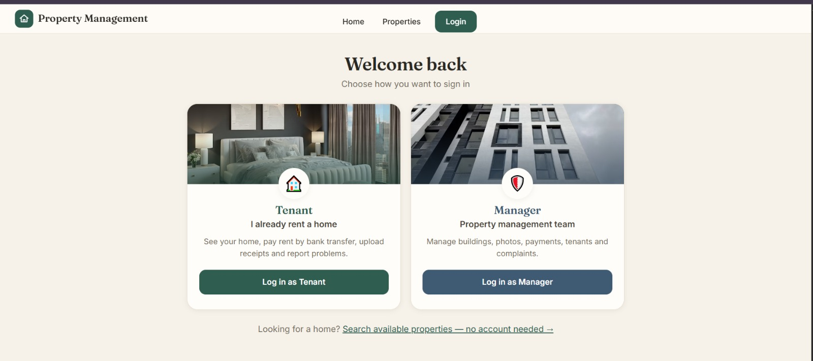
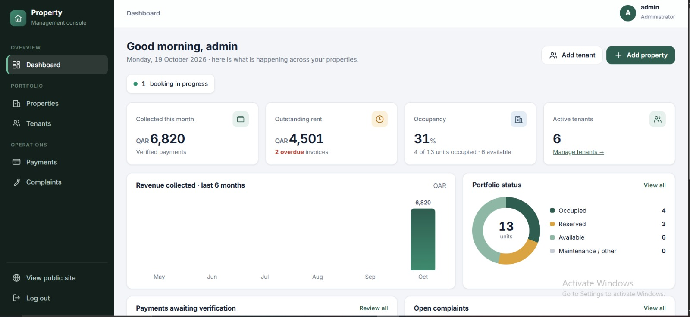
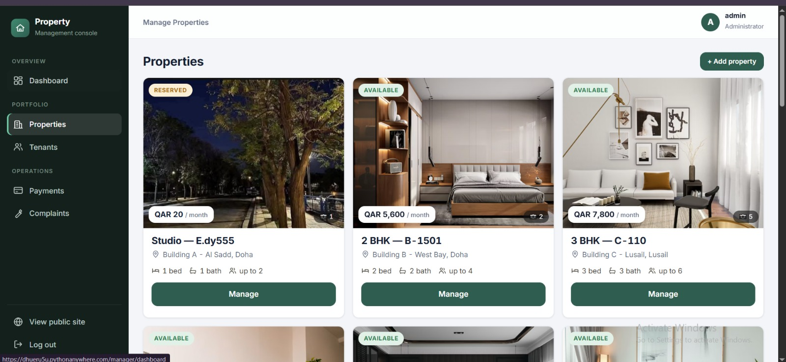

# 🏢 Cloud-Based Real Estate & Tenant Management System (SaaS)

A production-grade, mobile-friendly cloud platform designed to streamline real estate operations, rental bookings, tenant self-service, and maintenance ticket lifecycles[cite: 3, 4, 5]. Built with a robust **Python (Flask)** backend and integrated with **Supabase (PostgreSQL, Auth, & Object Storage)**[cite: 4, 8].

🌐 **Live Application:** [https://dhueru5u.pythonanywhere.com/](https://dhueru5u.pythonanywhere.com/)

---

## 📸 System Showcase & Visual Tour

### 1. 🌐 Public Customer Discovery Portal
* Allows prospective tenants to search available inventory, filter by property type (Studio, 1 BHK, 2 BHK, Villa) and max budget[cite: 4, 16].
* Displays property specs, photo galleries, and enables instant booking with unique IBAN reference generation[cite: 4, 5, 17, 19].

---

### 2. 🔐 Multi-Tenant Authentication & Portal Selection
* Dual-role portal gateway directing users to either the Tenant Self-Service Area or the Property Management Console[cite: 4, 5, 21].

---

### 3. 📊 Property Manager Analytics Dashboard
* Real-time financial and operational metrics, including collected monthly revenue, outstanding rent, occupancy rates, and pending payment verifications[cite: 4, 5, 20].

---

### 4. 🏢 Property Portfolio & Unit Inventory Management
* Complete inventory control allowing property managers to list units, toggle availability statuses, edit pricing, and manage media assets[cite: 4, 5, 17].

---

## 🏗️ System Architecture & Workflow Mechanics

### 🔄 1. Automated Booking & IBAN Payment Flow
1. **Application Submission:** Customer selects an available unit and submits personal/occupancy details[cite: 4, 18, 19].
2. **Reference Code Generation:** System automatically locks the unit context and generates a unique tracking code (e.g., `REA-2026-A203-0051`)[cite: 19].
3. **IBAN Transfer:** System presents company bank transfer details directly from database settings[cite: 19].
4. **Receipt Upload:** Customer uploads bank transfer receipt screenshot to cloud storage[cite: 4, 19].
5. **Manager Audit:** Property manager verifies arriving funds in bank records and clicks **Confirm Payment**[cite: 4, 20].
6. **State Transition:** Transaction status updates to `PAID`, Application to `APPROVED`, and Property status automatically switches to `RESERVED` / `OCCUPIED`[cite: 20].

---

### 🛠️ 2. Maintenance & Complaint Ticket Lifecycle
